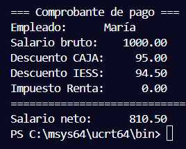
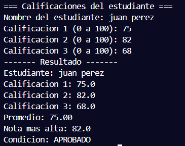
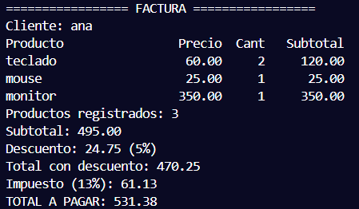

# AC2 · Mi primera aplicación en C

**Estudiante:** (nombre completo)  
**Fecha:** 20/10/2026  
**Módulo:** CSTI12010 Diseño de algoritmos · UA2

## Problema 1 · Nómina (AC2_P1_Nomina.c)

| Datos de entrada | Proceso | Datos de salida | Limitaciones |
|---|---|---|---|
- **Nombre del empleado**: cadena de texto (`char[]`). - **Salario bruto**: número flotante (`float`).[cite: 2] | 1. Solicitar el nombre del empleado y validar que no esté vacío utilizando `fgets` y `strlen`. 2. Solicitar el salario bruto y validar con un ciclo `do-while` que sea un monto mayor a 0. 3. Calcular el descuento de CAJA (9.5% sobre el bruto). 4. Calcular el descuento de IESS (2.5% sobre el bruto). 5. Verificar si el salario bruto supera los 800; de ser así, calcular el impuesto sobre la renta (10% sobre el excedente). 6. Calcular el salario neto sustrayendo la suma de todos los descuentos al salario bruto.[cite: 2] | Comprobante de pago detallado que contiene: - Nombre del empleado. - Salario bruto. - Descuento CAJA (9.5%). - Descuento IESS (2.5%). - Impuesto sobre la renta. - Salario neto con 2 decimales y montos alineados.[cite: 2] | - No se aceptan salarios brutos menores o iguales a 0. - El nombre del empleado no puede ser una cadena vacía. - El cálculo del impuesto de renta únicamente aplica cuando el salario bruto supera los 800.[cite: 2] |

**Ejecución con los datos del ejemplo:**

## Problema 2 · Calificaciones (AC2_P2_Calificaciones.c)

| Datos de entrada | Proceso | Datos de salida | Limitaciones |
|---|---|---|---|
| - **Nombre del estudiante**: cadena de texto (`char[]`). - **Tres calificaciones**: números flotantes (`float`) en un arreglo de tamaño 3.[cite: 3] | 1. Solicitar el nombre completo del estudiante. 2. Mediante un bucle `for` y validaciones `do-while`, solicitar y almacenar 3 calificaciones asegurando que se encuentren en el rango de 0 a 100. 3. Recorrer el arreglo para sumar las notas, calcular el promedio (`suma / 3`) y determinar la calificación más alta. 4. Evaluar la condición final mediante condicionales: &nbsp;&nbsp;- Promedio $\ge$ 70: "APROBADO" &nbsp;&nbsp;- Promedio entre 60 y 69.9: "EN RIESGO" &nbsp;&nbsp;- Promedio $<$ 60: "NO APROBADO" 5. Asignar el texto correspondiente a la variable condición mediante `strcpy`.[cite: 3] | Reporte de resultados que incluye: - Nombre del estudiante. - Las 3 calificaciones individuales. - Promedio final (con 2 decimales). - Calificación más alta. - Condición del estudiante (APROBADO / EN RIESGO / NO APROBADO).[cite: 3] | - Las calificaciones deben estar estrictamente entre 0 y 100; cualquier otro valor es rechazado. - Se evalúa una cantidad fija de 3 calificaciones por estudiante.[cite: 3] |

**Ejecución con los datos del ejemplo:**

## Problema 3 · Compras (AC2_P3_Compras.c)

| Datos de entrada | Proceso | Datos de salida | Limitaciones |
|---|---|---|---|
| - **Nombre del cliente**: cadena de texto (`char[]`). - **Datos por producto**: Nombre (`char[]`), precio unitario (`float`) y cantidad (`int`). - **Respuesta de continuidad**: Carácter (`S` / `N`).[cite: 4] | 1. Leer el nombre del cliente. 2. Mediante un bucle `while`, capturar hasta 10 productos guardándolos en arreglos paralelos (nombres, precios y cantidades). 3. Validar con `do-while` que el precio y la cantidad de cada producto sean positivos ($> 0$). 4. Calcular el subtotal por producto (`precio * cantidad`) y acumularlo en el subtotal general. 5. Preguntar si se desea agregar otro producto validando solo las opciones `S` o `N` (mayúscula o minúscula). 6. Determinar el porcentaje de descuento sobre el subtotal acumulado: &nbsp;&nbsp;- $<$ 100: 0% &nbsp;&nbsp;- 100 a $<$ 500: 5% &nbsp;&nbsp;- 500 a 1000: 10% &nbsp;&nbsp;- $>$ 1000: 15% 7. Calcular el total con descuento y sobre este aplicar el 13% de impuesto. 8. Mostrar el desglose de los productos y los totales consolidados.[cite: 4] | Factura detallada con: - Nombre del cliente. - Lista detallada de productos (nombre, precio, cantidad y subtotal). - Cantidad de productos registrados. - Subtotal acumulado. - Monto y porcentaje de descuento. - Total con descuento. - Monto del impuesto (13%). - Total a pagar final.[cite: 4] | - Máximo 10 productos por compra. - Precios y cantidades deben ser estrictamente mayores que 0. - La respuesta para agregar otro producto solo acepta los caracteres 'S', 's', 'N' o 'n'.[cite: 4] |

**Ejecución con los datos del ejemplo:**

## Conclusión

(Qué aprendí y qué fue lo más difícil de pasar de PSeInt a C.)

El paso de PSeInt a C representa una transición clave hacia el control explícito sobre la memoria y los tipos de datos. Durante el desarrollo de estos programas se aprendió a:
1. **Manejar arreglos y cadenas de caracteres:** A diferencia de PSeInt, en C las cadenas son arreglos de caracteres que requieren funciones específicas de `<string.h>` como `strcpy` para copias, `strlen` para medir longitudes y `strcspn` para remover saltos de línea al usar `fgets`[cite: 1, 3, 6].
2. **Gestionar el búfer de entrada:** La mayor dificultad consistió en limpiar correctamente el búfer de entrada (usando `getchar()`) entre lecturas numéricas con `scanf` y lecturas de texto con `fgets`, evitando que el salto de línea pendiente omitiera la entrada del usuario[cite: 4, 6].
3. **Formatear salidas numéricas:** Se dominó el uso de especificadores de formato en `printf` para alinear columnas y mostrar montos monetarios fijados exactamente a dos decimales (`%.2f`)[cite: 2, 6].